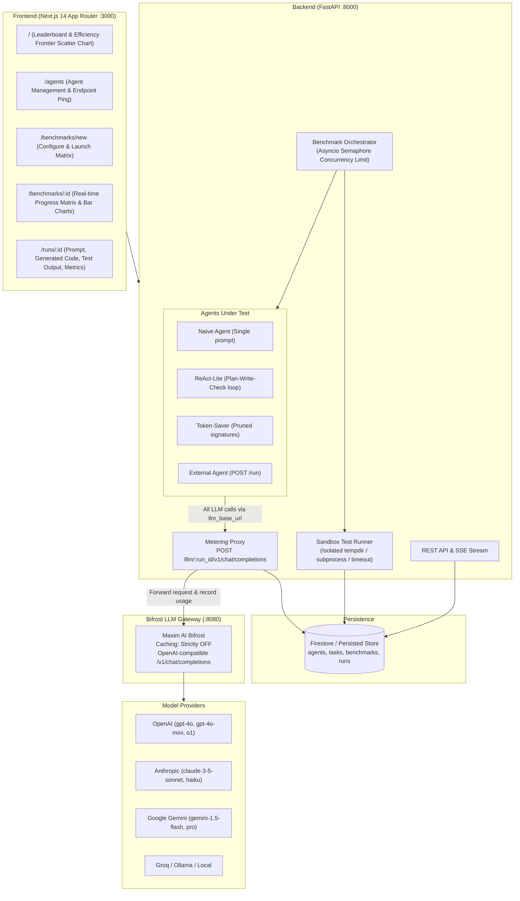

# AgentArena 🏟️
> **A standardized platform that benchmarks AI coding agents on identical tasks and measures how they really perform.**

AgentArena evaluates AI coding agents (regardless of what framework, library, or language they are built with) under identical conditions. Every single LLM call made by any agent is routed through our OpenAI-compatible metering proxy to **Bifrost** (by Maxim AI), ensuring unified, ungameable measurements of:
- **Token Usage** (Prompt Tokens, Completion Tokens, Total Tokens)
- **API Cost** (USD calculated via standardized provider pricing tables)
- **Execution Latency** (round-trip time in milliseconds)
- **Step / Call Counts**
- **Code Correctness & Pass Rate** (via automated unit tests executed in an isolated sandbox)

---

## Architecture Diagram



---

## The Agent Contract

Any external coding agent framework (LangChain, AutoGen, CrewAI, LlamaIndex, custom FastAPI, Node.js, etc.) can participate by implementing a single HTTP POST endpoint:

### Request: `POST {agent_endpoint}/run`
```json
{
  "run_id": "run_bench_123_myagent_task1_1794060861",
  "task": {
    "prompt": "Implement an LRUCache with O(1) get and put in solution.py...",
    "files": {
      "solution.py": "class LRUCache:\n    def __init__(self, capacity: int):\n        pass\n"
    }
  },
  "llm_base_url": "http://localhost:8000/llm/run_bench_123_myagent_task1_1794060861/v1",
  "llm_api_key": "arena-benchmark-token",
  "model": "openai/gpt-4o-mini",
  "limits": {
    "max_calls": 15,
    "max_tokens": 60000,
    "timeout": 60
  }
}
```

### Response:
```json
{
  "files": {
    "solution.py": "class LRUCache:\n    def __init__(self, capacity: int):\n        self.capacity = capacity\n        self.cache = {}\n..."
  },
  "notes": "Generated using LangChain ReAct agent in 2 reasoning steps"
}
```

> [!IMPORTANT]
> **The Golden Rule**: The agent **MUST** make all its LLM chat completion requests to `llm_base_url + "/chat/completions"`. The metering proxy verifies run status, enforces limits, measures tokens/cost/latency, and forwards to Bifrost. Calls made directly to OpenAI/Anthropic bypass metering and will not be recorded.

---

## 40-Line Example External Agent

A complete working example external agent is provided in [`example_agent/agent.py`](file:///example_agent/agent.py):

```python
import re
import httpx
from fastapi import FastAPI, Request

app = FastAPI(title="Example External Agent")

@app.post("/run")
async def run(request: Request):
    data = await request.json()
    task = data.get("task", {})
    prompt = task.get("prompt", "")
    llm_base_url = data.get("llm_base_url")
    llm_api_key = data.get("llm_api_key", "")
    model = data.get("model", "openai/gpt-4o-mini")

    messages = [
        {"role": "system", "content": "You are a software engineer. Return ONLY python code in ```python ... ```."},
        {"role": "user", "content": f"Task: {prompt}\nImplement solution.py:"}
    ]

    async with httpx.AsyncClient(timeout=45.0) as client:
        resp = await client.post(
            f"{llm_base_url.rstrip('/')}/chat/completions",
            json={"model": model, "messages": messages, "temperature": 0.2},
            headers={"Authorization": f"Bearer {llm_api_key}"}
        )
        resp_json = resp.json()

    content = resp_json.get("choices", [{}])[0].get("message", {}).get("content", "")
    match = re.search(r"```(?:python|py)?\n(.*?)```", content, re.DOTALL)
    code = match.group(1).strip() if match else content.strip()

    return {
        "files": {"solution.py": code + "\n"},
        "notes": "Generated by example external agent using AgentArena contract"
    }

if __name__ == "__main__":
    import uvicorn
    uvicorn.run(app, host="0.0.0.0", port=8001)
```

Run the example agent:
```bash
python example_agent/agent.py
```

---

## Built-in Reference Agents

AgentArena ships with 3 built-in reference agents:
1. **`naive`**: Single prompt containing the task description and starter files. Returns the code in one shot.
2. **`react-lite`**: Multi-turn reasoning agent. Plans -> writes initial code -> performs a self-critique loop checking for off-by-one errors and edge cases.
3. **`token-saver`**: Prunes prompt context to function signatures and utilizes terse instructions to minimize token usage and cost.

---

## Coding Tasks Suite

Located in [`backend/tasks/*.json`](file:///backend/tasks), spanning easy to hard difficulties with starter files and hidden `unittest` test suites:
1. `fizzbuzz-jazz`: Custom FizzBuzz variation (3->Fizz, 5->Buzz, 7->Jazz, 105->FizzBuzzJazz).
2. `parse-csv`: Robust CSV parser handling escaped commas, double quotes `""`, and whitespace without standard library `csv`.
3. `lru-cache`: LRU Cache implementation with $O(1)$ `get` and `put` operations and capacity eviction.
4. `buggy-binary-search`: Fix off-by-one errors and duplicates handling in binary search.
5. `case-converter`: Bidirectional conversion between camelCase, PascalCase, kebab-case, snake_case, and acronyms (`HTTPRequest`).
6. `interval-merger`: Merges overlapping interval arrays in sorted order.
7. `token-bucket`: Token bucket rate limiter supporting fractional refill rates and capacity bursts.
8. `bracket-validator`: Balanced brackets checker that correctly ignores brackets inside string literals and escaped quotes.
9. `matrix-pathfinder`: BFS shortest path in obstacle grid.
10. `json-schema-validator`: Schema validator for types, required keys, and nested object properties.

---

## How to Run

### Prerequisites
- Python 3.11+
- Node.js 18+ & npm
- Docker (for running Bifrost)

### 1. Configure Environment
Copy `.env.example` to `.env`:
```bash
cp .env.example .env
```
Fill in your provider API keys as needed (`OPENAI_API_KEY`, `ANTHROPIC_API_KEY`, `GEMINI_API_KEY`).

### 2. Start Bifrost LLM Gateway
Run Bifrost via Docker Compose:
```bash
docker compose up -d
```
Verify Bifrost is running at `http://localhost:8080/health`.
> **Note**: Caching is strictly disabled in `bifrost/config.json` (`auto_inject: false`, Local Cache plugin off) so every benchmark run reflects true token counts and latencies.
>
> **Bifrost Admin Dashboard Setup Token**: When accessing the Bifrost UI at `http://localhost:8080/`, enter the configured bootstrap token:
> ```
> agentarena-setup-token-secret
> ```

### 3. Seed Database & Start Backend
Install dependencies and seed the 10 tasks and 3 reference agents:
```bash
pip install -r backend/requirements.txt
python -m backend.seed
```

Start the FastAPI backend server:
```bash
uvicorn backend.main:app --reload --port 8000
```
Backend API docs are available at `http://localhost:8000/docs`.

### 4. Start Frontend
```bash
cd frontend
npm install
npm run dev
```
Open [http://localhost:3000](http://localhost:3000) in your browser.

---

## Documentation

Comprehensive guides are available in the [`docs/`](docs/) directory:
- [**System Architecture & Data Flow**](docs/ARCHITECTURE.md): State machine, metering pipeline, pricing tables, and sandbox isolation.
- [**Agent Contract Specification**](docs/AGENT_CONTRACT.md): Payload schemas, constraints, and instructions for integrating LangChain, AutoGen, CrewAI, or custom agents.
- [**REST API Reference**](docs/API_REFERENCE.md): Full documentation for all endpoints, query parameters, and SSE streams.

---

## Firestore Database & Indexes

AgentArena stores data in 4 core collections:
- `agents`: Metadata and endpoints for registered agents.
- `tasks`: Benchmark coding problems with starter files and hidden tests.
- `benchmarks`: High-level test suites and execution progress.
- `runs`: Individual agent evaluations with metered tokens, latency, cost, and test outputs.

If deploying to production Google Cloud Firebase Firestore, deploy composite query indexes defined in [`firestore.indexes.json`](firestore.indexes.json):
```bash
firebase deploy --only firestore:indexes
```

---

## Troubleshooting

- **`ModuleNotFoundError: No module named 'backend'`**: Run uvicorn from the project root:
  ```powershell
  cd C:\path\to\Bitfrost
  uvicorn backend.main:app --reload --port 8000
  ```
  Or if already inside `backend/`, run `uvicorn main:app --reload --port 8000`.
- **Virtual Environment**: Ensure you activate your virtual environment before running Python commands:
  ```powershell
  .\venv\Scripts\Activate.ps1
  ```
- **Bifrost Setup Token Prompt**: Enter `agentarena-setup-token-secret` when prompted by Bifrost at `http://localhost:8080`.

---

## Registering an External Agent

1. Launch your agent server implementing the `POST /run` contract (e.g. `http://localhost:8001/run`).
2. Navigate to `/agents` in the AgentArena UI.
3. Click **"Register External Agent"**.
4. Enter:
   - **Name**: e.g., `LangChain-ReAct`
   - **Endpoint**: `http://localhost:8001/run`
   - **Model**: `openai/gpt-4o-mini`
   - **Description**: Strategy or framework details
5. Click **"Test"** to ping connection.
6. Click **"Register Agent"**.

Now you can select your external agent in `/benchmarks/new` and evaluate it head-to-head against all reference agents!

---

## Verification & Testing

### Running Sandbox Runner Unit Tests
```bash
python -m unittest backend/tests/test_sandbox.py
```

### Running Full CLI Benchmark
Run all 3 reference agents across the entire task suite directly via CLI:
```bash
python -u backend/run_full_benchmark.py
```
This executes all 30 benchmarks, runs sandbox tests, updates the database, and prints the leaderboard summary table.

