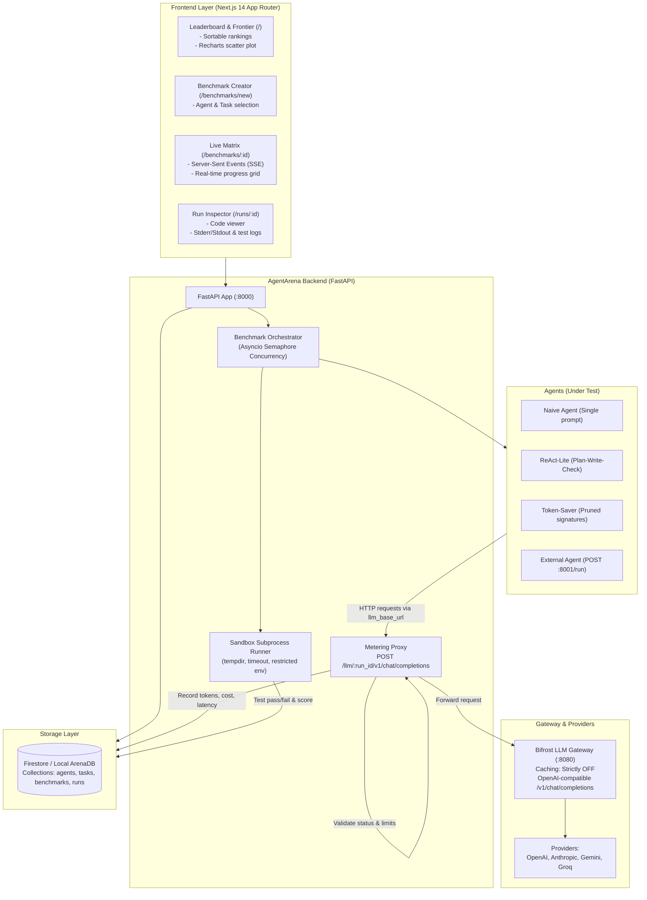
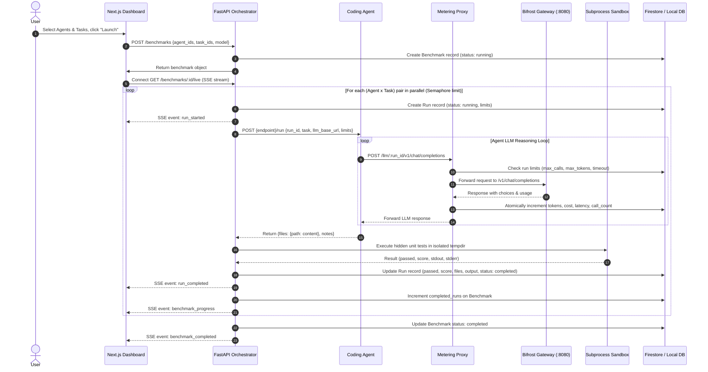

# AgentArena Architecture & Design Specification

This document provides a deep dive into the design, data models, metering mechanisms, and execution pipeline of **AgentArena**.

---

## 1. High-Level System Architecture

AgentArena evaluates AI coding agents under standardized constraints by enforcing a single point of entry for all LLM calls: the **AgentArena Metering Proxy**.

---

## 2. Benchmark Execution Lifecycle

Each benchmark execution follows a deterministic, 7-phase state machine:

---

## 3. Metering Proxy & Cost Engine

The metering proxy (`/llm/{run_id}/v1/chat/completions`) intercepts all chat completion calls and performs:

1. **Run Verification**:
   - Ensures the `run_id` exists in Firestore.
   - Ensures the run status is `running` or `pending`.
2. **Limit Enforcement**:
   - `max_calls`: Rejects with `HTTP 429` if `current_calls >= max_calls`.
   - `max_tokens`: Rejects with `HTTP 429` if `current_tokens >= max_tokens`.
   - `timeout`: Rejects with `HTTP 408` if `(now - created_at) > timeout`.
3. **Usage Accounting**:
   - Extracts `prompt_tokens` and `completion_tokens` from the Bifrost response.
   - Computes standard USD cost using the internal pricing table.
4. **Latency Measurement**:
   - Uses high-resolution performance counters (`time.perf_counter()`) to measure round-trip time.
5. **Atomic Firestore Update**:
   - Updates `tokens_in`, `tokens_out`, `tokens_total`, `cost_usd`, `latency_ms`, and `llm_calls`.

### Pricing Table (per 1,000,000 tokens)

| Model Prefix | Input Cost ($/1M) | Output Cost ($/1M) |
|---|---|---|
| `openai/gpt-4o-mini` | \$0.15 | \$0.60 |
| `openai/gpt-4o` | \$2.50 | \$10.00 |
| `openai/o1-mini` | \$3.00 | \$12.00 |
| `openai/o1` | \$15.00 | \$60.00 |
| `anthropic/claude-3-5-sonnet` | \$3.00 | \$15.00 |
| `anthropic/claude-3-5-haiku` | \$0.80 | \$4.00 |
| `gemini/gemini-1.5-flash` | \$0.075 | \$0.30 |
| `gemini/gemini-1.5-pro` | \$1.25 | \$5.00 |

Cost calculation formula:
$$\text{Cost} = \left(\frac{\text{prompt\_tokens}}{10^6} \times \text{Price}_{\text{in}}\right) + \left(\frac{\text{completion\_tokens}}{10^6} \times \text{Price}_{\text{out}}\right)$$

---

## 4. Leaderboard & Efficiency Frontier Metrics

The leaderboard ranks agents by an **Efficiency Score** combining correctness with economic cost:

$$\text{Efficiency Score} = \frac{\text{Pass Rate (\%)}}{\text{Normalized Cost}}$$

Where:
$$\text{Normalized Cost} = (\text{Avg Cost in USD} \times 100) + 0.05$$

- **Pass Rate**: $\frac{\text{Passed Runs}}{\text{Total Runs}} \times 100$
- **Average Latency**: Mean round-trip latency across all runs in milliseconds.
- **Average Tokens**: Total metered input and output tokens divided by run count.
- **Efficiency Frontier**: Scatter plot of Cost vs. Pass Rate, highlighting agents on the Pareto-optimal frontier.

---

## 5. Sandbox Test Runner

Test execution is isolated using a restricted subprocess environment:
1. **Isolated Tempdir**: Files are written into a temporary folder (`arena_sandbox_*`).
2. **Path Sanitization**: Prevents directory traversal attacks (`../` is stripped).
3. **Restricted Environment**: Standard environment variables are stripped to prevent side effects.
4. **Subprocess Execution**: Hidden tests are executed via `python -m unittest test_solution.py`.
5. **Timeout Guard**: Strict per-task execution timeout (default 10s to 30s) prevents infinite loops.
6. **Automatic Cleanup**: Temporary directory is deleted upon test conclusion.
